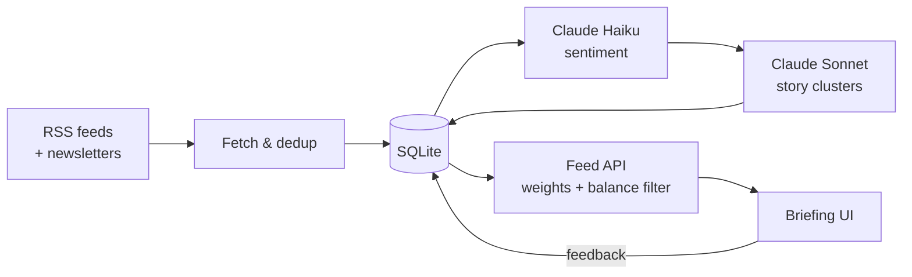

# SmartBrief

> Stay informed. Stay balanced. Stay sane.

SmartBrief is a self-hosted personal news app. It pulls the sources you trust (English and German), lets Claude merge duplicate coverage into one story, and serves a finite, sentiment-balanced briefing. You read it, you are done, you close the app.

## Why

Most news apps optimise for engagement, not for you:

- They push the most alarming headlines because alarm gets clicks.
- They show the same story ten times from ten outlets.
- They never tell you that you have read enough.

The result: you feel informed but anxious, or overwhelmed and numb.

SmartBrief turns this around:

| Problem | SmartBrief |
|---|---|
| Doomscrolling, infinite feed | Finite briefing with a "briefing complete" screen |
| Same story from 10 outlets | AI story clusters: one card, many sources, 3 to 5 bullets |
| Negativity bias | Every article gets a sentiment score. You set the ratio of positive / neutral / negative |
| Engagement algorithms you can't see | Feedback buttons that you control, with a visible "why am I seeing this?" |
| Tracking and ads | Runs on your machine. SQLite file. No accounts, no telemetry |

## Features

- **Story clusters.** Claude Sonnet groups articles about the same event across sources into one card with a summary and bullet points.
- **Sentiment balance.** Claude Haiku scores each article. Mood presets: Balanced (40/40/20), Constructive (60/35/5), Hard News (20/40/40), or your own ratio.
- **Finite sessions.** 5 to 30 stories per briefing, with a progress bar and an end screen.
- **Topic tabs.** Tech & AI, Science & Health, Business, World, and Bright Spots (only uplifting news).
- **20 built-in sources.** For example BBC, NPR, Wired, Ars Technica, Spiegel, Zeit, Tagesschau, Heise, Handelsblatt, SZ. Turn each one on or off.
- **Feedback learning.** 👍 👎 😔 🚫 🙈 per card. Source and topic weights adapt and fade out over time (30-day half-life).
- **Weekly recap.** Your news diet: topic mix, sentiment mix, bias spread.
- **Saved articles and clusters** for later reading.
- **Push notifications** for breaking news (opt-in, daily cap, quiet hours).
- **Newsletter ingestion** via IMAP inbox or webhook.
- **Runs in the browser.** Responsive layout and dark mode. Installable as a PWA (see the note on phone access below).
- **Backup.** Export and import your data from the settings page.

## How it works



A refresh runs when you tap the refresh button. There is no background schedule. Articles older than 30 days are pruned automatically, except saved ones.

## Quick start

### Prerequisites

- **Node.js 20 or newer** (`node -v`)
- **Claude access**, one of the two:
  - an Anthropic API key from [console.anthropic.com](https://console.anthropic.com), or
  - a logged-in [Claude Code](https://claude.com/claude-code) CLI on the same machine (set `CLAUDE_USE_LOCAL_SDK=true`)

Without Claude access the app still runs, but you get no sentiment scores and no story clusters.

### Install

```bash
git clone https://github.com/kevbu/SmartBrief.git
cd SmartBrief
npm install
```

### Configure

```bash
cp .env.local.example .env
```

Open `.env` and set at least:

```bash
ANTHROPIC_API_KEY=sk-ant-...      # or CLAUDE_USE_LOCAL_SDK=true
DATABASE_URL=file:./dev.db        # SQLite file, relative to prisma/
SMARTBRIEF_PASSWORD=              # leave empty for no login
```

Use `.env`, not `.env.local`: the Prisma CLI only reads `.env`. Both files are git-ignored.

### Create the database

```bash
npm run db:push
```

### Run

Development mode (hot reload):

```bash
npm run dev
```

Open [http://localhost:3000](http://localhost:3000) and tap refresh. The first refresh takes a minute or two, because Claude scores and clusters all new articles.

Production mode (faster, use this for daily reading):

```bash
npm run build
npm start
```

### Phone access (optional, advanced)

SmartBrief is not a mobile app. The server always runs on your computer, and with `CLAUDE_USE_LOCAL_SDK=true` it must run there, because it uses your local Claude Code login. The default use is the browser on that computer.

A phone can only open the app while the computer is on and reachable, for example in the same Wi-Fi via `http://<your-computer-ip>:3000`, or through a tunnel such as Tailscale. "Add to Home Screen" then gives you an app icon, but it is still only a window to your computer. Set `SMARTBRIEF_PASSWORD` before you make the app reachable from anywhere other than localhost.

## Configuration

| Variable | Required | Default | Purpose |
|---|---|---|---|
| `DATABASE_URL` | yes | – | SQLite file, e.g. `file:./dev.db` |
| `ANTHROPIC_API_KEY` | for AI features | – | Claude API key |
| `CLAUDE_USE_LOCAL_SDK` | no | `false` | `true` = use the local Claude Code login instead of an API key |
| `SMARTBRIEF_PASSWORD` | no | – | Enables a login page (30-day cookie). Empty = no auth |
| `SMARTBRIEF_RETENTION_DAYS` | no | `30` | Delete articles older than this. `0` = keep everything |
| `NEXT_PUBLIC_APP_URL` | for push | – | Public URL of the app, used for Web Push |
| `NEWSLETTER_INGEST_SECRET` | no | – | Enables `POST /api/ingest/newsletter` |
| `IMAP_HOST`, `IMAP_PORT`, `IMAP_USER`, `IMAP_PASS`, `IMAP_FOLDER`, `IMAP_TLS`, `IMAP_POLL_INTERVAL_MINS` | no | – | Poll an inbox for newsletters |

Feed preferences (sources, mood, session length) live in the app under **Settings**, not in env vars.

### Costs

SmartBrief uses Claude Haiku 4.5 for sentiment and Claude Sonnet 4.6 for clusters. With the API key you pay per refresh. A few refreshes per day stay in the range of cents. With `CLAUDE_USE_LOCAL_SDK=true` the calls count against your Claude subscription instead.

## Running it permanently (optional)

### macOS background service

Run a production build as a launchd agent, so the app starts on login. Point `WorkingDirectory` at your checkout and run `npm start` (or `next start -p 3000`). `scripts/deploy-local.sh` shows how the maintainer's setup pulls, builds and restarts. It expects the agent label `com.kevbu.smartbrief`; override with `SMARTBRIEF_LAUNCHD_LABEL`.

### Docker

```bash
docker build -t smartbrief .
docker run -d --name smartbrief -p 3000:3000 \
  -e ANTHROPIC_API_KEY=sk-ant-... \
  -e DATABASE_URL=file:/app/data/smartbrief.db \
  -v "$(pwd)/data:/app/data" \
  smartbrief
```

The container creates the schema on start. `docker-compose.yml` is the maintainer's old VPS setup (pre-built image and an external proxy network). Adapt it before use.

## Privacy

- No accounts, no telemetry, no ads, no third-party scripts.
- Data leaves your machine only for two things: fetching RSS feeds, and sending article titles and snippets to Anthropic for scoring and clustering.
- All data sits in one SQLite file. Delete the file and it's gone.

## Development

```bash
npm test          # unit tests (Vitest)
npm run e2e       # end-to-end tests (Playwright, own dev server + throwaway DB)
npx tsc --noEmit  # type check
npm run db:studio # browse the database
```

Tech stack: Next.js 16 (App Router), TypeScript, Tailwind CSS, Prisma + SQLite, Anthropic SDK.

Further reading:

- [CLAUDE.md](CLAUDE.md): architecture and data flow
- [docs/product.md](docs/product.md): vision, personas, roadmap
- [docs/infrastructure.md](docs/infrastructure.md): env vars, push, newsletter setup
- [docs/backlog.md](docs/backlog.md): open work

## Status

SmartBrief is a personal, single-user app. One instance serves one reader with one set of preferences. Each colleague runs their own instance. Issues and pull requests are welcome.
